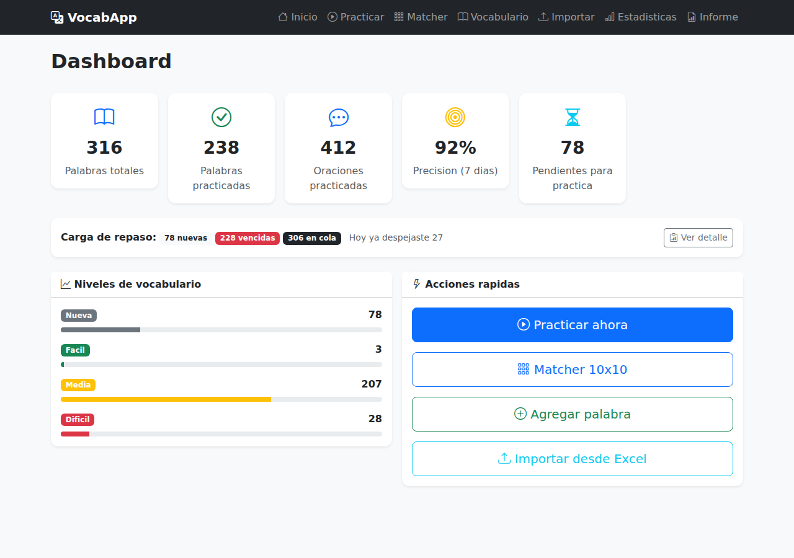
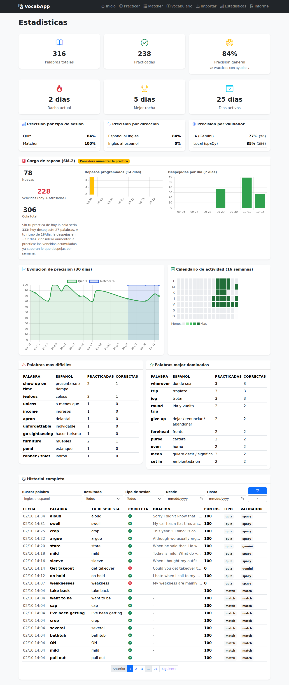
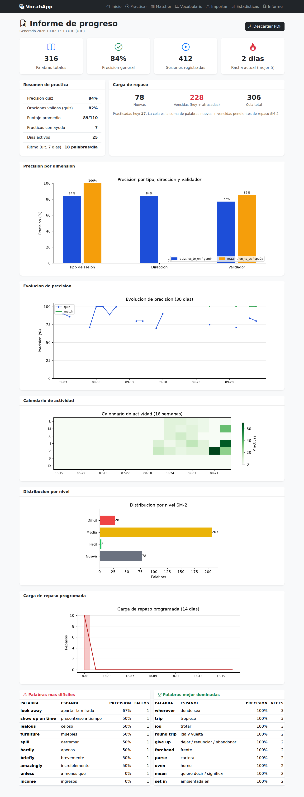
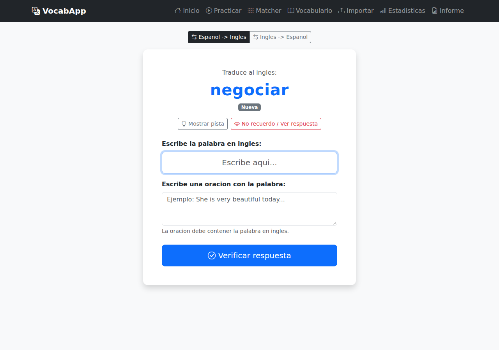
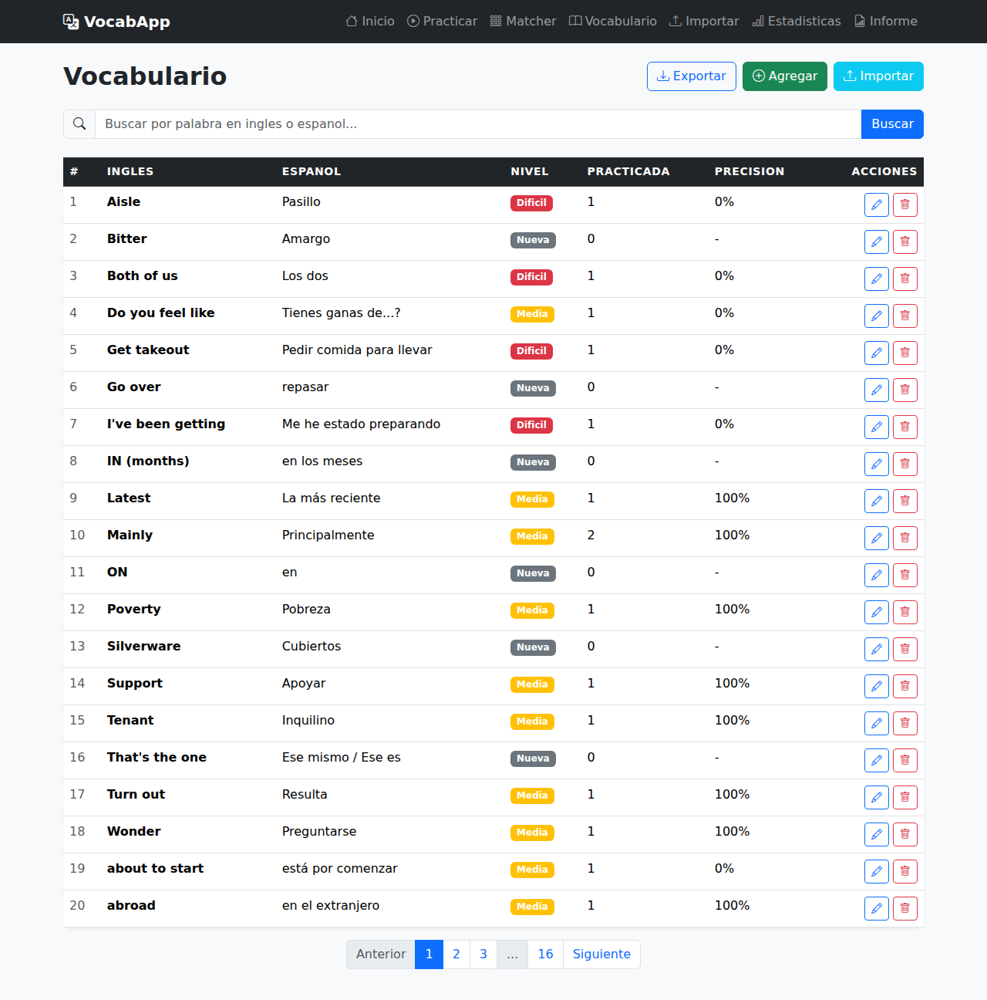

# VocabApp

> On-premise web app for reviewing English-Spanish vocabulary with **spaced repetition** and **NLP verification**.

[](https://www.python.org/)
[](https://flask.palletsprojects.com/)
[](https://spacy.io/)
[](https://www.sqlite.org/)
[](https://opensource.org/licenses/MIT)

> **🌐 Spanish version / Versión en español:** [README.md](README.md)

---

## Description

VocabApp is a **Learning Analytics**-oriented web application that turns an English-Spanish vocabulary study routine into a measurable, analyzable, and reproducible process.

The system records every practice session as structured data — answers, quality, difficulty, session type and direction, validator used, use of help, and timestamps — and transforms it into performance, behavior, and learning-load indicators.

The project integrates the full Data Analytics cycle: data capture → relational storage → transformation and aggregation → KPI definition → analysis → visualization → reporting.

The analytics layer uses Python, Pandas, and Matplotlib to produce metrics and visualizations about accuracy, performance evolution, activity, vocabulary difficulty, and future review load. Results are presented through tracking dashboards and a consolidated report exportable to PDF.

The main dimensions analyzed include:

- **Performance:** historical and recent accuracy, score, correct answers, and practice quality.
- **Segmentation:** accuracy by session type, translation direction, difficulty level, and validation source.
- **Behavior:** active days, practice streaks, study frequency, and use of hints.
- **Learning load:** new words, overdue reviews, practice pace, and review projection using SM-2 Spaced Repetition.
- **Time evolution:** 7- and 30-day performance trends, 16-week activity, and reviews scheduled over the next 14 days.

A central aspect of the project is metric integrity and traceability. Every indicator is documented with its definition, formula, data source, and calculation criterion, avoiding ambiguous or inflated numbers. For example, practices where the user requests to reveal the answer are explicitly recorded with `was_revealed`, preventing accuracy from overestimating real performance.

The app also includes NLP with spaCy and optional validation via Google Gemini, using an automatic fallback mechanism to keep practice going when the external service is unavailable or exceeds the configured time budget.

The SM-2 algorithm uses the quality of each answer to adapt review intervals, allowing you to analyze not only historical performance but also future learning load.

The project was developed through an agentic development flow with OpenCode, using AI agents as support during implementation, testing, debugging, and documentation, while keeping control over the architecture, metrics, business rules, and result validation.

Overall, VocabApp shows how an application can become an analytical product, where the data generated by app usage feeds a reproducible pipeline that turns user events into KPIs, insights, and reports for decision-making.

---

## Key Features

- **SM-2 Spaced Repetition** — Words are scheduled for review based on performance. Difficult words appear more often; mastered words are spaced further apart.
- **NLP Sentence Validation** — spaCy validates that the English word (or multi-word expression) appears in the sentence. Supports single words, lemmas, and complete phrases (e.g. "get lost", "show up on time"). Also validates auxiliary verbs (is/are/was/were/be). Optional **Gemini** (AI) validator with automatic fallback adds suggestions for corrected sentences.
- **Excel Bulk Import** — Import hundreds of words at once from an `.xlsx` file via the web UI or CLI.
- **Progress Tracking** — Dashboard, statistics with accuracy metrics, word difficulty levels, session history, and a consolidated server-side report (`/report`) with PDF export.
- **Fully Local** — Runs on `127.0.0.1:5000`. No cloud, no accounts (the only optional cloud piece is the Gemini validator).

---

## Screenshots

Main app views with real study data (regenerable with
`python3 scripts/take_screenshots.py`):

| View | Image |
|---|---|
| Dashboard (summary + SM-2 review load) |  |
| Statistics (accuracy by factor, streaks, history) |  |
| Progress report (pandas + matplotlib, 5 charts) |  |
| Quiz with NLP validation |  |
| Vocabulary (CRUD + import/export) |  |

The report can also be downloaded as a multi-page PDF (`screenshots/demo-informe.pdf` is a sample generated from `/report/pdf`).

---

## Features

| Feature | Description |
|---|---|
| **Interactive Quiz** | Shows a Spanish word → the user types the English translation → writes a sentence |
| **Reverse direction** | English→Spanish selector (default: Spanish→English); the direction is saved and feeds direction-based accuracy |
| **Recall help** | Always-visible hint (with default text) and a "I don't remember / Show answer" button that marks the word as an honest failure (`was_revealed`) |
| **NLP verification** | spaCy (local) with optional Gemini (AI): word/phrase present with inflections, verbs (VERB + AUX), minimum 3 tokens; corrected sentence suggestions and a guaranteed time budget |
| **Matcher mode** | Matches up to 10 Spanish/English words; records activity without altering the SM-2 curve |
| **Level system** | 4 levels: New, Easy, Medium, Hard — with automatic progression |
| **SM-2 Spaced Repetition** | SuperMemo 2 algorithm: adjusts interval, easiness factor, and next review |
| **Review load (SM-2)** | Sustainable queue panel: new/overdue/backlog, daily pace, projection, and reviews scheduled over 14 days |
| **Dashboard** | Summary: total words, practiced, weekly accuracy, pending reviews, and review load card |
| **Vocabulary CRUD** | Add, edit, delete, search, and paginate words |
| **Excel Import / Export** | Upload `.xlsx` files from the browser or CLI; export vocabulary + progress |
| **Statistics** | Hardest/best-mastered words, filterable history, streaks, accuracy by type/direction/validator, 30-day evolution, and a 16-week activity calendar |
| **Progress report** | `/report` with 5 charts (pandas + matplotlib) and multi-page PDF export at `/report/pdf` |

---

## Tech Stack

| Component | Technology | Version |
|---|---|---|
| Backend | Python + Flask | 3.14 / 3.1.1 |
| ORM | Flask-SQLAlchemy | 3.1.1 |
| Migrations | Flask-Migrate (Alembic) | 4.1.0 |
| Database | SQLite | local file |
| NLP | spaCy + en_core_web_sm | 3.8.x |
| AI validation | Google Gemini (google-genai) | 2.25.0 |
| Analytics | pandas | 3.0.6 |
| Charts / PDF | matplotlib (Agg) | 3.11.2 |
| Excel | openpyxl | 3.1.5 |
| Frontend | Bootstrap 5 + Jinja2 | CDN |
| Icons | Bootstrap Icons | 1.11.3 |

---

## Installation

### Prerequisites

- Python 3.10 or higher
- pip
- (Optional) Excel file with vocabulary in `.xlsx` format

### Step by step

```bash
# 1. Clone the repository
git clone https://github.com/guillerdc006/VocabApp.git
cd VocabApp

# 2. Create a virtual environment (recommended)
python -m venv venv
source venv/bin/activate        # Linux/macOS
venv\Scripts\activate           # Windows

# 3. Install dependencies
pip install -r requirements.txt

# 4. Download the spaCy model
python -m spacy download en_core_web_sm

# 4b. Gemini API key (optional; enables AI validation)
# Create a .env file in the project root (already in .gitignore):
#   GEMINI_API_KEY=your-key
#   NLP_VALIDATOR=gemini      # 'spacy' disables it
#   GEMINI_TIMEOUT_MS=9000    # time budget (ms) for Gemini before falling back to spaCy (default 9000)

# 5. (Optional) Import vocabulary from Excel
python import_excel.py                          # uses Vocabulary.xlsx by default
python import_excel.py path/to/your/file.xlsx   # or specify a file

# 6. Run the app
python run.py
```

The app will be available at: **http://127.0.0.1:5000**

> **Note:** The database is created/updated automatically in `instance/vocabulary.db` (SQLite in WAL mode) on app startup: `create_all()` creates new tables and Alembic migrations (`flask db upgrade`) version schema changes. Data is never destroyed with `drop_all()` against the real database.

---

## Usage

### Matcher (`/study/match`)
Match up to 10 Spanish/English words across two columns. Completing the pairs records the session in the history with type `match` without altering the quiz's SM-2 curve.

### Dashboard (`/`)
General summary with total words, practiced words, 7-day accuracy, words pending review, and a review load card (new/overdue/queue). Includes quick access to the main features.

### Quiz (`/study/quiz`)
Shows a Spanish word (or English, with the direction selector); the user types the translation and a sentence. NLP verification and SM-2; the chosen direction is kept in the session.

Recall help (bar below the word, always visible):
- **Hint** (`bi-lightbulb`): reveals the word's note. If there is none, it shows *"The word has no note."*.
- **I don't remember / Show answer** (`bi-eye`): fills in the correct translation and locks it as read-only. The word half is automatically counted as incorrect (0 out of 50 points), even if the text turns out correct afterwards; the sentence still scores normally. The practice is marked `was_revealed` and shows up in the statistics as "Practices with help".

> The result is served via GET (PRG pattern). Reloading the page does not re-record the practice or double the count.

### Vocabulary (`/vocabulary/`)
Paged list (20 per page) with search by English or Spanish word. Allows adding, editing, and deleting words, and exporting the whole vocabulary + progress to Excel.

### Import (`/vocabulary/import`)
Upload an `.xlsx` file with `english`/`spanish` columns (or `ingles`/`espanol`). Duplicates are skipped automatically.

### Statistics (`/study/stats`)
Overall accuracy, hardest words, best-mastered words, and the full paged history with filters (word, correct/incorrect, session type, date range). Plus: current and best practice streak, active days, accuracy by session type (quiz/matcher), direction (es-en / en-es) and validator (AI Gemini / spaCy), a "practices with help" counter (revealed answer), an SM-2 review load panel (new/overdue/queue, reviews scheduled over 14 days, daily pace and projection), an accuracy evolution chart (30 days, with series by type) and a 16-week activity calendar.

### Report (`/report`)
Server-generated consolidated progress report (pandas for analysis, matplotlib for charts): key metrics, practice summary, review load, accuracy by type/direction/validator, 30-day evolution, activity calendar, SM-2 level distribution, reviews scheduled over 14 days, and hardest/best-mastered word tables. A **"Download PDF"** button (`/report/pdf`) exports it as a multi-page report (informe-progreso-YYYYMMDD.pdf).

> **Time zone (UTC):** all timestamps and "today" boundaries are computed in **UTC**. The system runs in `America/Guayaquil` (UTC-5), so the UTC day rolls over at **7:00 PM local time**: between 7 PM and midnight local, a practice is recorded with the next day's UTC date.

### Measurements dictionary
[`MEDICIONES.md`](MEDICIONES.md) documents how **every metric and every visual** in the app is calculated (what it measures, formula/definition, data source, and objective), plus the objective of each service. It is the reference guide for reading the app's numbers, for re-implementing the project from scratch, or for presenting it as a portfolio.

### Tests (pytest)
```bash
pip install -r requirements-dev.txt   # installs pytest
python -m pytest                       # runs the whole suite
```
Tests use an isolated database in `/tmp`; they never touch `instance/vocabulary.db`.

### Migrations (Flask-Migrate / Alembic)
```bash
FLASK_APP=run.py flask db init       # only once (already done)
FLASK_APP=run.py flask db migrate -m "description"   # generates the migration
FLASK_APP=run.py flask db upgrade    # applies the migration to the DB
```

---

## Architecture

### Application Factory Pattern

```
run.py  →  app/__init__.py (create_app())  →  Blueprints  →  Routes  →  Templates
                              ↓
                    extensions.py (db, migrate: SQLAlchemy + Alembic instances)
                              ↓
                         models.py (Word, WordStats, SessionHistory)
                              ↓
        services/ (sm2, nlp_validator, excel_import, analytics, reporting)
```

### Blueprints

| Blueprint | Prefix | Purpose |
|---|---|---|
| `main_bp` | `/` | Dashboard and home page |
| `vocab_bp` | `/vocabulary` | Vocabulary CRUD + Excel import |
| `study_bp` | `/study` | Quiz, result, matcher, and statistics |
| `report_bp` | `/report` | Progress report and PDF export |

### Database Schema

```
┌──────────────────────────┐     ┌────────────────────────────────┐
│          words           │     │           word_stats            │
├──────────────────────────┤     ├────────────────────────────────┤
│ id (PK)                  │──1:1│ word_id (FK, UNIQUE)            │
│ english (UNIQUE)         │     │ repetitions                     │
│ spanish                  │     │ easiness_factor (SM-2 EF)       │
│ notes                    │     │ interval (days)                 │
│ created_at               │     │ times_practiced                 │
└──────────────────────────┘     │ times_correct (total hits)      │
                                 │ level (0 New..3 Hard)           │
                                 │ next_review  (UTC, next)        │
                                 │ last_practiced (UTC)            │
                                 └────────────────────────────────┘
                                               │
                                 ┌─────────────────────────────────┐
                                 │         session_history          │
                                 ├─────────────────────────────────┤
                                 │ id (PK)                         │
                                 │ word_id (FK)                    │
                                 │ english_answer (what was typed) │
                                 │ sentence (user's sentence)      │
                                 │ sentence_details (NLP feedback) │
                                 │ sentence_suggestion (AI)        │
                                 │ is_correct (word half)          │
                                 │ sentence_valid (sentence half)  │
                                 │ was_revealed (used help)        │
                                 │ score (0-110)                   │
                                 │ quality (SM-2: 0-5)             │
                                 │ session_type (quiz/match)       │
                                 │ direction (es_to_en/en_to_es)   │
                                 │ validator_source (gemini/spacy) │
                                 │ created_at (UTC)                │
                                 └─────────────────────────────────┘
```

**How the database works:**

- **Single SQLite file in WAL mode** (`PRAGMA journal_mode=WAL`, `busy_timeout=5000`, `foreign_keys=ON`) at `instance/vocabulary.db`. WAL mode allows concurrent reads with a single writer and is more crash-resistant; backup uses `sqlite3.Connection.backup()` (never `cp`).
- **Three relational tables:** `words` (1 word) → `word_stats` (1 SM-2 progress record per word, 1:1 relationship) and `session_history` (N practice sessions per word). No other tables.
- **UTC, naive timestamps:** all time records (`created_at`, `next_review`, `last_practiced`) are computed with `datetime.now(timezone.utc)`, and SQLite stores them as naive `datetime`, always interpreted as UTC by the analytics services (`analytics.py`, `reporting.py`). No conversion to local time is made.
- **Lifecycle:** `db.create_all()` creates new tables on startup (idempotent), and existing schema changes are versioned with **Flask-Migrate/Alembic** (`migrations/`), applied with `flask db upgrade`. `drop_all()` is never used against the real DB: `GuardedSQLAlchemy` (`extensions.py`) blocks it unless `ALLOW_DESTRUCTIVE_OPERATIONS=1`.
- **Before migrating or debugging:** run `python3 scripts/backup_db.py` (produces `instance/vocabulary.db.bak-YYYYMMDD-HHMMSS` and verifies the word count).

### SM-2 Spaced Repetition Algorithm

The SM-2 algorithm (SuperMemo, 1987) determines each word's next review based on the answer's quality:

**Quality** (0-5), where:
- `5` = Perfect answer + valid sentence
- `4` = Correct answer but invalid sentence
- `3` = Incorrect answer but valid sentence
- `1` = Both incorrect

**Easiness factor (EF) update:**
```
EF' = EF + (0.1 - (5 - q) * (0.08 + (5 - q) * 0.02))
EF = max(1.3, EF')
```

**Interval determination:**
- If `q < 3` (failure): `repetitions = 0`, `interval = 1 day`
- If `q >= 3` (success):
  - 1st repetition: `interval = 1 day`
  - 2nd repetition: `interval = 6 days`
  - Following: `interval = ceil(previous_interval * EF)`

### NLP Validation Pipeline

Sentence validation has **two interchangeable providers** with the same output
contract `{ valid, word_found, has_verb, token_count, details, suggestion }`:

1. **AI (Gemini)** — default if `GEMINI_API_KEY` is in `.env` and `NLP_VALIDATOR=gemini`.
   A call to `Models.generate_content` (model `gemini-3.6-flash`, configurable) judges:
   the word/phrase (allowing inflections: go -> went/gone), whether there is a main verb, and
   the length; when the sentence fails it returns a **suggestion** for a corrected sentence that
   is saved in the history and shown in the result.
2. **Local (spaCy)** — automatic fallback if Gemini is not configured, fails, or does not respond
   in time. It does not make suggestions.

**Guaranteed latency:** Gemini validation runs with a **time budget**
(`GEMINI_TIMEOUT_MS`, default `9000` ms in `.env`). The default was set by measuring the API's
real latency (typically 6-8 s in this environment): with `3000` ms Gemini almost never finished
in time and practice always fell back to spaCy. If the API does not respond within the budget
(free-tier errors such as `429` for quota, or slowness under high demand), it falls back to spaCy
and the quiz never hangs: the worst-case wait is the budget (< 9 s). The HTTP deadline per attempt
is fixed at `10000` ms (the API minimum; the UX cutoff is imposed by the budget).
To wait longer for Gemini on slow days, raise `GEMINI_TIMEOUT_MS` (useful maximum ~`9500`); for an
even more instant response at the cost of fewer AI validations, lower it.

```
Input: user's sentence + target word
                    ↓
  validate with Gemini? (config + key)
    ├─ Yes ──▶ Gemini API ──▶ { valid, details, suggestion }  (validator_source="gemini")
    └─ No/fail ──▶ spaCy en_core_web_sm (validator_source="spacy")
                    ↓
    Checks (spaCy):
    ✓ Full word/phrase present in the sentence
      (substring + consecutive tokens in order)
    ✓ Sentence contains at least one verb (POS: VERB or AUX)
    ✓ Minimum length: 3 tokens (excluding punctuation)
                    ↓
    Result: { valid: bool, details: str }
```

Every practice stores who validated (`validator_source`) and the suggestion
(`sentence_suggestion`) in `SessionHistory`, which allows breaking down accuracy by validator in
the statistics and showing a "Validated with AI" badge on the practice result.

**Multi-word support:** Expressions like "get lost", "show up on time", or "to be honest" are
validated by checking that all tokens appear consecutively in the sentence, in the same order.

**Auxiliary verbs:** spaCy tags "is/are/was/were/be" as `AUX` instead of `VERB`. The validator
accepts both categories so it does not reject correct sentences like "She is beautiful" or
"They were ready".

---

## Project Structure

```
VocabApp/
├── run.py                          # Entry point — starts Flask on localhost:5000
├── requirements.txt                # Python dependencies
├── requirements-dev.txt            # Testing dependencies (pytest, spaCy model)
├── README.md / README_EN.md        # Documentation in Spanish and English
├── setup.sh                        # Automatic installation script
├── import_excel.py                 # CLI to import Excel files
├── Vocabulary.xlsx                 # Sample dataset (256 words)
├── .env                            # Local config (Gemini keys, NLP_VALIDATOR, timeout)
├── .gitignore
├── AGENTS.md                       # Work guide: real DB, backup, tests
├── LICENSE                         # MIT License
│
├── instance/                       # Local data (gitignored)
│   ├── vocabulary.db               # Real database (SQLite, WAL)
│   └── vocabulary.db.bak-*         # Backups generated by scripts/backup_db.py
│
├── migrations/                     # Schema versioning (Flask-Migrate/Alembic)
│   └── versions/                   # 990ceaa573c9, b6ed4e264721, 7b07b91d82c0, ...
│
├── screenshots/                    # README captures (portfolio)
│   ├── 01-dashboard.png, 03-estadisticas.png, ...
│   └── demo-informe.pdf
│
├── scripts/
│   ├── backup_db.py                # Safe DB backup (sqlite3.backup)
│   └── take_screenshots.py         # Headless captures of the views (Playwright)
│
├── tests/                          # pytest suite (isolated DB per test)
│   ├── conftest.py                 # app/client fixtures + offline suite
│   ├── test_smoke.py               # Smoke tests for all routes
│   ├── test_ia.py                  # Gemini/spaCy validation + budget
│   ├── test_report.py              # /report report and PDF
│   ├── test_practica_con_ayuda.py  # "I don't remember / Show answer" button
│   ├── test_hint.py, test_reverse_quiz.py, test_match.py, ...
│   └── ...
│
└── app/                            # Main application package
    ├── __init__.py                 # create_app() — Application Factory
    ├── config.py                   # Configuration (SECRET_KEY, DB URI, Gemini)
    ├── extensions.py               # SQLAlchemy + Migrate (with GuardedSQLAlchemy)
    ├── models.py                   # Models: Word, WordStats, SessionHistory
    │
    ├── routes/                     # Blueprints (presentation layer)
    │   ├── main.py                 # Dashboard (/)
    │   ├── vocabulary.py           # CRUD + import (/vocabulary/*)
    │   ├── study.py                # Quiz, matcher, stats (/study/*)
    │   └── report.py               # Report (/report, /report/pdf)
    │
    ├── services/                   # Business logic
    │   ├── sm2.py                  # SM-2 Spaced Repetition algorithm
    │   ├── nlp_validator.py        # Sentence validation (spaCy + Gemini)
    │   ├── excel_import.py         # Excel file reading with openpyxl
    │   ├── analytics.py            # Statistics (streak, load, heatmap, ...)
    │   └── reporting.py            # pandas + matplotlib report (+PDF)
    │
    ├── templates/                  # Jinja2 templates
    │   ├── base.html               # Base layout (navbar, Bootstrap 5)
    │   ├── main/index.html         # Dashboard
    │   ├── vocabulary/             # list, add, edit, import
    │   ├── study/                  # quiz, result, stats, match
    │   └── report/report.html      # Progress report
    │
    └── static/css/
        └── style.css               # Custom styles
```

---

## Excel Format

The Excel file must have two columns with these headers:

| Column A | Column B | Column C (optional) |
|---|---|---|
| `english` (or `ingles`) | `spanish` (or `espanol`) | `notes` (or `observacion`) |

Example:

| english | spanish |
|---|---|
| get lost | perderse |
| nowadays | hoy en dia |
| delighted | encantado |

> Variations with and without accents are accepted (`ingles`/`Inglés`, `espanol`/`Español`).

---

## Case study: what your review data says

This project closes the full cycle of an **analyst** in a real solution. The report
(`/report` and the downloadable PDF) turns raw data into study decisions. The metrics can
be read as a set of testable hypotheses about your learning:

**1. Review load is the sustainability indicator.** SM-2 schedules each word; the queue
= new + overdue pending words. If "overdue today + backlog" exceeds what you clear per week,
the queue inevitably grows: the panel warns you ("Consider increasing practice time").
It is the same diagnosis a CRM would make about a customer backlog.

**2. Accuracy by type, direction, and validator separates the factors.** The three
statistics tables (and the report's first chart) tell you *where* you lose points: if
`match` accuracy is high but `quiz` is low, the problem is active production (writing) rather
than recognition. If `en_to_es` falls below `es_to_en`, the deficit is in productive Spanish
vocabulary. And the validator table separates the word's real difficulty from evaluator noise
(a sentence badly validated by spaCy is not your failure).

**3. The spaced retention curve.** Combining the 30-day evolution (by type) with the calendar
and the level distribution shows how many words have passed at least one review (levels 1-3)
versus those still "New" (never-reviewed queues). The report joins them in a single capture to
decide, for example, whether it is better to increase the review pace or consolidate the
current level.

**4. The honest record of help (`was_revealed`).** When you use "I don't remember /
Show answer", the answer is marked as a failure and counted as a "practice with help".
Without that record, real accuracy would be optimistic: that is what a good analyst calls
reporting bias. With the counter you can measure how many words you solve without effort and
decide whether the button is becoming a shortcut.

**5. Safe interpretation of time.** Everything is recorded in UTC (the system runs in
`America/Guayaquil`, UTC-5), so "today" is consistent regardless of local time; the report
carries a UTC generation timestamp so an analytical capture is reproducible and comparable
with others.

The full flow —capture with SM-2 from scratch, continuous improvement of the evaluator
(spaCy -> Gemini with fallback), bounded performance, and a self-contained report— shows how a
usage database (SQLite) and an analytics pipeline (pandas + matplotlib) combine into a small
but complete product.

---

## Data Analytics Approach (portfolio)

This project is designed to demonstrate **data analyst skills** applied to a real product,
not a toy dataset:

| Skill | Where it is demonstrated |
|---|---|
| **Relational data modeling** | Fact table `session_history` + dimensions `words` / `word_stats` (see `Database Schema`): designing the schema and keeping consistency (`SUM(times_practiced)` == quiz sessions). |
| **ETL/aggregations with pandas** | `app/services/reporting.py`: a single pandas pass builds metrics, performance tables, and distributions from SQLite without duplicating logic. |
| **Visualization with matplotlib** | 5 charts (accuracy by dimension, 30-day evolution, activity heatmap, levels, review skyline) rendered server-side with the `Agg` backend and exported to **multi-page PDF**. |
| **Well-defined metrics** | [`MEDICIONES.md`](MEDICIONES.md): every metric with its exact formula, data source, and criterion (avoids ambiguous or inflated numbers). |
| **Data → decision** | "Case study" section: SM-2 queue as sustainable backlog, accuracy diagnosis by factor (type/direction/validator), spaced retention, and bias detection (`was_revealed`). |
| **Reproducibility** | All time in UTC; the report carries a generation timestamp to make analytical captures comparable. |
| **Data testing** | Suite of 118 tests with isolated DB: fixtures, synthetic data, and numeric verification of aggregations. |

If you have your own study data (or want to connect another app), the analytics layer is
independent of the UI: `analytics.py` and `reporting.py` work only on the tables.

---

## Changelog

### v1.20.1 (2026-09-29) — Gemini validates again: budget adjusted to real latency
- During practice it was observed that validation **always** fell back to spaCy. Diagnosis: it was
  not congestion but the default budget (`GEMINI_TIMEOUT_MS=3000` ms) being **lower than the API's
  real latency** in this environment, measured with the configured key: successful attempts of
  ~6.2 s and ~7.8 s (and one case exceeding the 10 s HTTP deadline).
- At 3000 ms the cutoff (`future.result(timeout=3)`) fired almost always, causing the silent
  fallback to spaCy.
- Adjustment: **default to `9000` ms** (`app/config.py`, `.env`, and docs). The measured average
  latency (~7 s) fits within the budget, leaving margin before the `10000` ms HTTP deadline.
  Still configurable per environment.
- Tests: timeout defaults updated (`tests/test_ia.py`). Full suite **118 passed**.

### v1.20 (2026-09-25) — Progress report (`/report`) and PDF export
- New `/report` route with a server-generated consolidated report: key metrics, practice summary
  (quiz accuracy, valid sentences, average score, practices with help, pace), review load, five
  charts (accuracy by type/direction/validator, 30-day evolution, 16-week activity calendar, SM-2
  level distribution, and reviews scheduled over 14 days) and hardest/best-mastered word tables.
- The analysis is built with **pandas** (aggregations by type, direction, and validator; level
  distribution; performance lists) and charts are rendered with **matplotlib** (Agg backend, no
  windows). A single pass generates the embedded web PNGs and the downloadable **multi-page PDF**
  at `/report/pdf` (informe-progreso-YYYYMMDD.pdf) at A4 resolution.
- New pinned dependencies: `pandas==3.0.6` and `matplotlib==3.11.2`.
- Read-only on the DB: the report never writes data. Tests in `tests/test_report.py` (5). Full
  suite **118 passed**.

### v1.19.1 (2026-09-25) — Bounded validation latency
- Gemini validation now runs with a **time budget** (`GEMINI_TIMEOUT_MS`, default `3000` ms,
  configurable in `.env`): if the API does not respond in time (e.g. `429` for quota or slowness
  under high demand on the free tier), validation falls back to spaCy and the quiz never hangs.
  The HTTP deadline per attempt stays at `10000` ms (the API minimum) and the UX cutoff is imposed
  by the budget.
- Previously the wait could reach 10-20 s (20 s deadline + retries). Now the worst case is the
  budget and the typical case is < 1 s.
- New tests: timeout config (default/env/invalid) and fast fallback to spaCy if Gemini is slow.
  Full suite **113 passed**.
- Git version control was established with rollback point `5efd638` (complete v1.19, before this
  change).

### v1.19 (2026-09-25) — Recall help in practice
- The hint ("Show hint") is now **always visible** in the quiz, also for words without a note: in
  that case it shows "The word has no note."
- New "I don't remember / Show answer" button next to the hint: it fills in the correct
  translation as read-only and **marks the word half as incorrect automatically** (0/50), even if
  the text matches the answer; the sentence still scores (Gemini/spaCy) and SM-2 gives quality 3
  if valid.
- New `was_revealed` column in `session_history` (Alembic migration `7b07b91d82c0`, with prior
  backup). The result shows the "You used help" notice and the statistics add the "Practices
  with help" counter.
- Tests in `tests/test_practica_con_ayuda.py` (7) and `tests/test_hint.py` updated. Full
  suite **109 passed**.

### v1.18 (2026-09-25) — AI sentence validation (Gemini + spaCy)
- AI config: `.env` loading via `python-dotenv`; keys `GEMINI_API_KEY`, `NLP_VALIDATOR` (default
  `gemini`) and `GEMINI_MODEL` (default `gemini-3.6-flash`) in `app/config.py`, with helpers
  `get_api_key()`/`get_validator()`/`get_model()`. SDK `google-genai==2.25.0` pinned in
  `requirements.txt`.
- Dispatcher in `app/services/nlp_validator.py`: same signature/output contract for both providers.
  `_gemini_validate_sentence()` judges word (with inflections), main verb, and length, and returns
  `suggestion` when something fails; 20 s timeout and automatic fallback to spaCy on any error or
  503 under high demand.
- The quiz stores `validator_source` (`gemini`/`spacy`) and `sentence_suggestion` in
  `SessionHistory` (columns already present; no migrations). The result shows the "Validated with
  AI" badge and the corrected suggestion.
- Statistics: new "Accuracy by validator" table (AI Gemini vs local spaCy, with session counts).
- The test suite is kept airtight without network (autouse fixture in `conftest.py`) with a mocked
  Gemini client. Tests in `tests/test_ia.py` (13): config, parser, pipeline, quiz integration.
- README: NLP Validation Pipeline section updated and installation guide with `.env`.

### v1.17.1 (2026-09-25) — Documented time zone
- Documented (README and AGENTS.md) that all timestamps and "today"/day boundaries in analytics
  are computed in **UTC**; the system runs in `America/Guayaquil` (UTC-5) and the UTC day rolls
  over at 7:00 PM local time. No code or DB changes.

### v1.17 (2026-09-24) — Review load (SM-2)
- New "Review load (SM-2)" panel in the statistics: Pending new, Overdue (today + backlog) and
  total Queue, with context note ("without today's practice the queue would be X; today you
  cleared Y"), day projection to clear the queue based on the average pace (7 days), and a
  "consider increasing your practice" warning if overdue exceeds what is cleared weekly.
- Bar chart of reviews scheduled over the next 14 days and words cleared per day (7 days), both
  with Chart.js via CDN.
- Compact summary card on the Dashboard (`/`) linking to the detail.
- The 30-day accuracy evolution now splits by type: Quiz and Matcher series on the same chart
  (each type is only drawn if it had activity).
- `app/services/analytics.py`: `daily_accuracy_by_type()`, `review_skyline()`,
  `daily_practice_rate()`. Tests in `tests/test_carga_repaso.py` (7) + `test_visualizations.py`
  extended.

### v1.16 (2026-09-24) — Reverse-direction quiz
- Direction selector in the quiz: Spanish→English (default) or English→Spanish. With the latter,
  the English word is shown and the Spanish translation is requested; the sentence is still
  validated in English (NLP).
- The chosen direction is saved in the session and in every history record (`direction=en_to_es`),
  feeding the accuracy-by-direction statistics. The result shows the word and correct answer
  according to the direction.
- Tests in `tests/test_reverse_quiz.py` (7).

### v1.15 (2026-09-24) — Matching mode
- New matcher practice mode: match up to 10 words (Spanish/English) across two columns. The
  selection highlights the chosen item, hits turn green and misses red; completing all pairs saves
  the session to history with `session_type=match`.
- The matcher records activity in the history and feeds the statistics (accuracy by type), but it
  does NOT alter the SM-2 curve (`next_review`/levels remain managed by the quiz).
- Routes `GET/POST /study/match[/complete]`, template `study/match.html`, access from navbar and
  dashboard. Tests in `tests/test_match.py`.

### v1.14 (2026-09-24) — Visualizations (statistics)
- Accuracy evolution chart for the last 30 days (Chart.js via CDN) with per-day tooltip
  (accuracy and sessions).
- Activity heatmap-style calendar for the last 16 weeks (intensity by daily sessions) with legend
  and tooltips. Days in UTC, consistent with streaks.
- `app/services/analytics.py`: functions `daily_accuracy()` and `activity_weeks()`. Tests in
  `tests/test_visualizations.py`.

### v1.13.3 (2026-09-24) — Safety guard
- `GuardedSQLAlchemy` blocks `db.drop_all()` when the engine points to the real database
  (`instance/vocabulary.db`), unless `ALLOW_DESTRUCTIVE_OPERATIONS=1`. `create_all` is not blocked
  (idempotent; used on startup). Verified live: the real DB was not touched.
- Tests in `tests/test_guard.py` (real DB recognition, blocking, and flag bypass).

### v1.13.2 (2026-09-24) — Tools
- New `scripts/backup_db.py`: safe backup of the real DB (`sqlite3.backup` API) with count
  verification. Run before any change.
- New `AGENTS.md` with the context to avoid data loss: secure connection pattern (config inside
  `create_app`, never reassign the URI after), mandatory prior backup, and reference to
  `tests/conftest.py`.

### v1.13.1 (2026-09-24) — Data recovery
- Incident: a debugging script ran `drop_all()`/`create_all()` against the real database (the
  SQLAlchemy engine already pointed to it), emptying the tables.
- Recovery: database restored from backup `vocabulary.db.bak-20260918-1200` (305 words,
  305 progress records, 210 sessions) and migration `b6ed4e264721` (enriched session columns)
  reapplied.
- Immediate new backup: `vocabulary.db.bak-20260924-2200`.
- Caution for debugging: mount the temporary DB inside `create_app` (via config), never reassign
  `SQLALCHEMY_DATABASE_URI` after its creation.

### v1.13 (2026-09-24)
- **Statistics:** new analysis metrics: current streak (consecutive practice days), best historical
  streak, active days, and accuracy segmented by session type and review direction. Practice times
  handled in UTC to avoid timezone drift.

### v1.12 (2026-09-18)
- **Statistics:** full paged history (20 per page) with filters by word, result
  (correct/incorrect), session type, and date range — replaces the fixed list of the last 20.
  New Type and Validator columns.

### v1.11 (2026-09-18)
- **Data:** `session_history` enriched with `session_type` (quiz/match), `direction`
  (es_to_en/en_to_es), `validator_source` (spacy/ai) and `sentence_suggestion`. Migration applied:
  historical sessions kept coherent default values. Base for multi-mode analytics and AI
  validation.

### v1.10 (2026-09-18)
- **Excel export:** "Export" button in the listing — downloads `vocabulario_export.xlsx` with
  words + notes + progress (level, practiced count, correct, accuracy, next review). Re-importable
  file without duplicating (round-trip).

### v1.9 (2026-09-18)
- **Excel import:** support for an optional 3rd column (`notes` / `observacion`) to load hints
  along with the words. Without the column, import works the same as before.

### v1.8 (2026-09-17)
- **Quiz:** "Show hint" button in the quiz — if the word has a note, it reveals the hint on click
  (hidden by default so the answer is not given away).

### v1.7 (2026-09-17)
- **CRUD:** word editing from the list (`/vocabulary/edit/<id>`) — allows correcting English,
  Spanish, and notes **without losing stats or history**. Pencil button in each row.
- **CRUD:** "Note / hint" field also available when adding words.

### v1.6 (2026-09-17)
- **Data:** `notes` field (note / hint) added to the `Word` model via a Flask-Migrate migration.
  No existing data is lost.
- **Quality:** Flask-Migrate (Alembic) officially enabled — new migrations in `migrations/`.
  Schema changes are now versioned and reversible.

### v1.5 (2026-09-17)
- **Quality:** pytest test infrastructure — isolated in-memory test DB (never touches
  `instance/vocabulary.db`), app/client fixtures.
- **Quality:** Smoke tests for all routes (dashboard, quiz, result, statistics, CRUD, search,
  pagination, Excel import). Green suite as baseline before new features.

### v1.4 (2026-09-11)
- **Quiz:** never-practiced words (`next_review IS NULL`) now take priority over words pending an
  SM-2 re-review. New words are exhausted before overdue ones reappear.
- **Data:** fixed the word "get lost" (id 1), whose SM-2 fields were desynchronized after an
  earlier cleanup (it had `next_review` defined but `times_practiced=0`), leaving it invisible in
  both dashboard cards. Its fields were restored to a never-practiced state.

### v1.3 (2026-09-11)
- **Dashboard:** "Practiced" card renamed to "Practiced words" (distinct words with at least
  1 practice).
- **Dashboard:** new "Practiced sentences" card with the total sessions (written sentences).
- **Dashboard:** "To practice" card replaced by "Pending practice" — shows only words never
  reviewed (`next_review IS NULL`), removing ambiguity with words pending an SM-2 re-review.

### v1.2 (2026-08-24)
- **Fix:** PRG pattern (POST-redirect-GET) — the quiz result is now served via GET at
  `/study/result/<id>`. Prevents double counting when reloading the page (F5) or resubmitting the
  form.
- **Fix:** SQLite configured with `PRAGMA journal_mode=WAL`, `busy_timeout=5000`, and
  `foreign_keys=ON` — removes `database is locked` errors that prevented recording practices under
  simultaneous requests.
- **Fix:** error-tolerant NLP verification — if spaCy fails, the practice is still recorded with
  the sentence marked invalid.
- **Data:** new `session_history.sentence_details` column to track sentence feedback on the result
  page.
- **Fix:** practice count reconciled (`SUM(times_practiced)` == history records).

### v1.1 (2026-08-21)
- **Fix:** NLP validator now supports multi-word expressions ("get lost", "show up on time", etc.)
  by checking consecutive tokens in order.
- **Fix:** auxiliary verbs (is/are/was/were/be) are now accepted as valid verbs in sentence
  verification (POS: `AUX`).

### v1.0 (2026-08-20)
- Initial release: quiz, SM-2 spaced repetition, Excel import, vocabulary CRUD, statistics.

---

## License

Distributed under the **MIT License**. See `LICENSE` for more information.

```
MIT License

Copyright (c) 2026 guillerdc006

Permission is hereby granted, free of charge, to any person obtaining a copy
of this software and associated documentation files (the "Software"), to deal
in the Software without restriction, including without limitation the rights
to use, copy, modify, merge, publish, distribute, sublicense, and/or sell
copies of the Software, and to permit persons to whom the Software is
furnished to do so, subject to the following conditions:

The above copyright notice and this permission notice shall be included in all
copies or substantial portions of the Software.

THE SOFTWARE IS PROVIDED "AS IS", WITHOUT WARRANTY OF ANY KIND, EXPRESS OR
IMPLIED, INCLUDING BUT NOT LIMITED TO THE WARRANTIES OF MERCHANTABILITY,
FITNESS FOR A PARTICULAR PURPOSE AND NONINFRINGEMENT. IN NO EVENT SHALL THE
AUTHORS OR COPYRIGHT HOLDERS BE LIABLE FOR ANY CLAIM, DAMAGES OR OTHER
LIABILITY, WHETHER IN AN ACTION OF CONTRACT, TORT OR OTHERWISE, ARISING FROM,
OUT OF OR IN CONNECTION WITH THE SOFTWARE OR THE USE OR OTHER DEALINGS IN THE
SOFTWARE.
```

---

## 👨‍💻 Author

**Guillermo Dominguez Crespo**

MSc in Information Systems (Data Science) | Electronics Engineer

* LinkedIn: [https://www.linkedin.com](https://linkedin.com/in/guillermodominguezcrespo)
* GitHub: [https://github.com](https://github.com/guillerdc006)